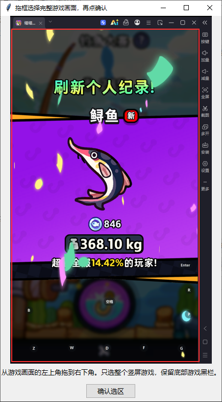

# tt_fish · 钓鱼助手

面向 Windows 和雷电模拟器的 Python 图像识别钓鱼工具。通过屏幕截图判断阶段，以空格完成下钩、拉钩、黄条判定和结算返回，不读取游戏内存。

[GitHub 项目](https://github.com/zz11-m/tt_fish) · [作者的哔哩哔哩主页](https://space.bilibili.com/488950689) · [更新记录](CHANGELOG.md)

> 本项目免费提供，用于学习与交流。无需购买授权、激活码或收费解锁；请从上面的项目地址获取源码。

## 功能

- 自动识别准备下钩、等待上钩、拉钩、黄条判定和结果展示。
- 支持跳过黄条或连续多轮黄条判定。
- 支持普通“开心收下”及蓝色、紫色、金黄色纪录结算页，包括“刷新团队纪录”画面。
- 结果页等待后持续重试空格，避免首次按键没有被接受而停住。
- 不停钓、次数／时长限制、截图间隔和快捷键可配置。
- 失焦暂停、手动紧急暂停、截图、手动录制和离线回放。

## 环境与安装

- Windows，Python 3.10 或以上。
- 雷电模拟器中的竖屏游戏画面，比例约336∶598。
- Anaconda、PyCharm或普通Python环境均可；脚本不要求服务器。

完整下载或克隆本仓库后，在项目目录运行：

```bash
python -m pip install -r requirements.txt
python main.py
```

使用PyCharm时，打开包含 `main.py` 的项目文件夹，选择安装好依赖的解释器，直接运行该文件。Anaconda已安装依赖时无需重新安装。程序使用Tkinter界面；若解释器不包含Tkinter，可在对应Conda环境安装 `tk`。

## 设置空格映射

在模拟器中，将空格映射到**圆形钓鱼按钮下半部与“开心收下”按钮重叠的位置**。这一位置应能在两种界面中都落入按钮内。

分别手动确认：空格可以下钩、拉钩、完成黄条操作，并关闭“开心收下”和纪录结算页。程序始终只发送空格，不会自动改按回车。不要把空格映射放在聊天框或其他按钮上。

## 框选完整游戏画面

1. 运行程序，选择对应雷电窗口。
2. 点击“2. 框选完整游戏画面”，在3秒内切回该模拟器。
3. 在截图里从游戏左上角拖到右下角，确认选区。

**只选完整的竖屏游戏区域。模拟器标题栏、右侧工具栏和游戏外侧的黑边不要选；游戏内部的底部黑色栏要保留。** 不要只框鱼、黄条或钓鱼按钮，也不要漏掉顶部、左右边缘或底部界面。

下图红框是正确示例。示例处于结果页，其他钓鱼阶段使用相同的完整游戏选区。程序内的“查看框选示例”也可打开此图。



调整模拟器窗口大小、分辨率或显示比例后，应停止监测并重新框选。仅移动窗口时程序会跟随其位置。游戏必须保持可见且无遮挡。

## 开始与暂停

1. 在“钓鱼选项”中设置是否不停钓、截图间隔以及次数／分钟上限。
2. 点击“3. 应用设置并开启监测”。此时只进行截图识别，尚未自动钓鱼。
3. 切回模拟器按开始快捷键，默认 **F8**；或者点击“4. 3秒后启动钓鱼”，立即切回模拟器。
4. 顶部出现“自动按空格 · 运行中”后开始操作。

默认不勾选“仅观察”；勾选后只查看识别结果，不发送空格。每次打开软件都保持暂停，不会自行操作。

点击助手、浏览器或其他窗口会使模拟器失焦并暂停。返回模拟器后需要重新启动。点击项目链接或打开框选示例也会暂停操作。关闭程序会停止后台循环并释放本程序按下的空格。

| 功能 | 默认快捷键 |
|---|---|
| 开始／暂停 | F8 |
| 紧急暂停、取消3秒启动 | F9 |
| 保存游戏截图 | F10 |

在“快捷键与延迟”页可改为F1～F12中的其他键，三个键不能重复。修改前停止监测，修改后重新点击第3步应用。界面显示当前生效键，避免与模拟器或其他软件的热键冲突。

## 不停钓与截图频率

勾选“不停钓”后，次数和分钟两个上限都不生效，完成结算后继续下一条。取消勾选后恢复限制。每次重新启动钓鱼会重新计算次数和时长。

持续模式仍会因手动暂停、失焦、长时间无法识别、动作无响应等情况停止，不会盲目点击未知弹窗或购买、补充鱼饵等按钮。

“每多少帧截图一次”接受1～60的整数，按**每秒60个基准帧**换算时间，不读取游戏内部帧号。

| 输入值 | 截图间隔 | 每秒截图目标 |
|---:|---:|---:|
| 3 | 50毫秒 | 20次 |
| 6（默认） | 100毫秒 | 10次 |
| 10 | 约167毫秒 | 6次 |
| 12 | 200毫秒 | 5次 |

数值越大，截图和识别次数越少，电脑占用通常更低；同时也更容易错过快速浮标、短暂上钩提示或很窄的黄条。先使用默认6，仍卡顿可增至10或12，错过判定则可减至3或4。界面显示实际截图次数，预览最多每秒刷新4次；卡顿后不会补抓积压帧。

## 结算与黄条判定

结果页连续确认后默认等待3秒，再按空格。如果画面仍是纪录结算页或“开心收下”，约每1秒重试一次，每次间隔随机浮动±40毫秒，没有重试次数上限。每次操作都依据新截图；离开结算页后停止关闭动作，确认初始界面后再下钩。系统卡顿和截图处理可能延长实际间隔。

“开心收下”通过标题、绿色按钮局部和暗背景组合识别。纪录页通过重量图标、蓝色／紫色／金黄色面板和暗背景组合识别，不依赖鱼的名称或“个人／团队纪录”标题。未知界面仍不按键。纪录页与收下页之间切换共用一次结算流程。

黄条阶段根据浮标位置、短时速度和输入延迟判断时机，按下后等待下一轮变化。预览绿框表示黄色目标范围，红线表示浮标，紫线表示预测生效位置。目标太窄、被遮挡或速度不稳定时可能暂缓操作；不保证每轮都能命中。

## 设置与升级

设置在点击第3步时保存到本机 `config.json`，首次使用无需手工创建。`config.example.json` 仅用于展示默认配置，不包含任何个人框选。

| 常用配置 | 默认 | 含义 |
|---|---:|---|
| `continuous_fishing` | false | 勾选后忽略次数与分钟上限 |
| `capture_every_n_frames` | 6 | 每N个基准帧截图一次 |
| `input_latency_ms` | 40 | 预计按键生效延迟，不是按住时长 |
| `key_hold_ms` | 35 | 单次空格按住时长 |
| `result_wait_s` | 3 | 结算首次等待秒数 |
| `result_retry_s` | 1 | 结算重试基准间隔 |
| `result_retry_jitter_ms` | 40 | 结算重试间隔浮动毫秒数 |
| `max_casts` | 20 | 未勾选不停钓时的下钩次数上限 |
| `max_session_minutes` | 15 | 未勾选不停钓时的分钟上限 |

更新到新目录时，可复制旧版的本机 `config.json` 保留设置与框选，避免覆盖旧日志和录像。旧版0.1配置会迁移截图和结算节奏；1.0配置按原值保留。窗口尺寸变化后重新框选。发布到GitHub时不要上传自己的 `config.json`。

## 日志、录制和排查

日志保存在 `logs/`，截图保存在 `snapshots/`。每个会话的当前日志与两份轮转文件合计约6 MiB，旧会话保留。

在“录制”页点击录制，3秒内切回模拟器并手动操作15秒。录制期间自动按键暂停；视频及逐帧时间戳保存在 `recordings/`。

| 现象 | 检查方法 |
|---|---|
| 第3步后没有动作 | 还需第4步或开始快捷键；查看顶部是否“运行中”、是否勾选仅观察 |
| “开心收下”未退出 | 查看是否识别为“开心收下”；手动确认空格映射落在两个按钮的重叠区 |
| 一直显示未知画面 | 检查框选是否遗漏或带外侧黑边，是否遮挡、弹窗或界面样式变化 |
| 按键没有被游戏接受 | 检查映射、聊天焦点，以及程序和模拟器是否使用相同权限级别 |
| 运行中突然暂停 | 查看顶部具体原因；切到其他窗口会失焦暂停 |
| 黄条容易错过 | 减小截图间隔，核对浮标定位与按键延迟 |

离线检查和分析不发送系统输入：

```bash
python selfcheck.py
python replay.py
python replay.py --input recordings/manual_xxx.avi
python replay.py --input my_video.mp4 --crop 0 0 540 960
```

不传 `--input` 时分析上面的框选示例。`--crop` 依次为输入图像中的左、上、宽、高，应按自己的素材填写。回放推算的动作不代表真实游戏执行结果。

诊断包默认只打包公开源码。需要附加数据时明确选择：

```bash
python make_support_bundle.py
python make_support_bundle.py --include-logs
python make_support_bundle.py --include-logs --include-screenshots --include-video
```

诊断数据可能含昵称、聊天内容或本机路径，检查后再分享。程序不会自动上传。更多说明见 [本地数据与公开发布](docs/PRIVACY.md)。

## 上传与贡献

本发布包解压后的 `README.md`、`main.py`、`fisher/`、`assets/` 等应放在仓库根目录，不再额外套一层工程文件夹。

在本机运行或修改后，使用以下入口生成可公开发布的源码包：

```bash
python selfcheck.py
python build_release.py
```

只上传 `dist/tt_fish-版本号.zip` 解压后的内容。该入口使用明确文件清单，排除本机配置、日志、截图、录像、缓存和额外个人文件；`.gitignore` 同时用于Git工作流。不要直接上传未经检查的整个运行目录或诊断包。

欢迎通过GitHub Issues提交可复现的问题。开发结构与验证方式见 [开发说明](docs/DEVELOPMENT.md)。

## 许可与使用边界

源码采用 [GPL-3.0-only](LICENSE)。允许学习、修改和再分发；分发修改版时需要按许可证保留相关声明并提供相应源码。第三方游戏界面和模板的权利范围见 [NOTICE.md](NOTICE.md)。

作者免费提供本项目，但GPL本身允许收费再分发，并不是“禁止售卖”许可。请认准公开源码和作者入口，不要为所谓激活码、官方授权或解锁功能付款。相关许可说明可查阅 [GNU GPL常见问题](https://www.gnu.org/licenses/gpl-faq.html#DoesTheGPLAllowMoney)。

工具仅在本机处理截图及输入，不代表不会被游戏检测。使用前请确认游戏和平台允许该操作方式；不保证特定设备、所有鱼种或后续游戏版本的成功率。
